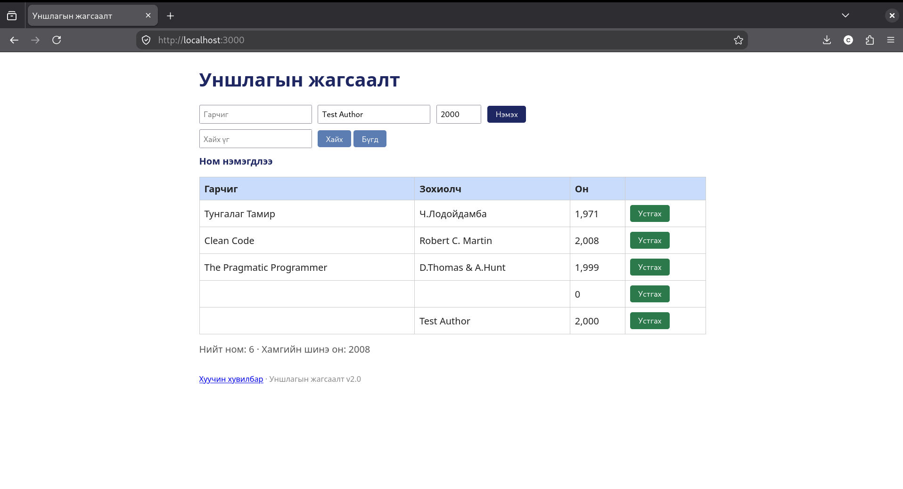
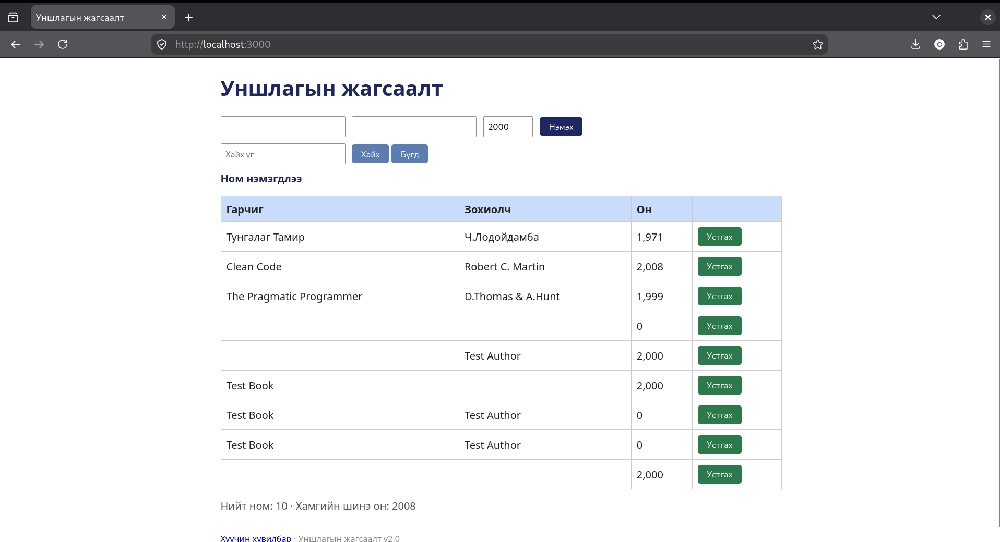

# BUG-01: Шаардлагатай талбар дутуу байхад ном нэмэгддэг

## Орчин

- Апп: Уншлагын жагсаалт v2.0
- Node.js: v20.19.2
- Git: 2.47.3
- curl: 8.14.1
- browser: Mozilla Firefox 153.4.0esr
- Үйлдлийн систем: Linux
- Огноо: 2026-10-20

## Урьдчилсан нөхцөл

Дахин шалгахдаа `node app.js`-ийг шинээр асааж, http://localhost:3000 хуудсыг шинэчилнэ. Анхны 3 номтой төлөвөөс эхэлнэ.

## Дахин гаргах алхам

1. http://localhost:3000 хаягийг нээнэ.
2. Гарчгийг хоосон үлдээнэ.
3. Зохиолчид `Test Author`, онд `2000` оруулна.
4. Аппын ном нэмэх товчийг дарна.

## Хүлээгдэж байсан үр дүн

Гарчиг, зохиолч, он бүгд шаардлагатай тул ном нэмэгдэхгүй, ойлгомжтой алдаа харагдана.

## Бодит үр дүн

Гарчиггүй ном нэмэгдсэн; алдааны мессеж харагдаагүй.

## Ноцтой байдал

Major — Шаардлагатай мэдээлэлгүй ном нэмэгдэж байна.

## Нотолгоо

## Олдсон аялал

Couch Potato - шаардлагатай талбаруудыг хоосон үлдээж шалгах үед илэрсэн.

## Нэмэлт тэмдэглэл

Session-д бүх талбар хоосон, зохиолч дутуу, он дутуу, зөвхөн зайтай хувилбарууд мөн нэмэгдсэн. Эдгээрийг нэг согогийн хувилбар гэж нэгтгэсэн.