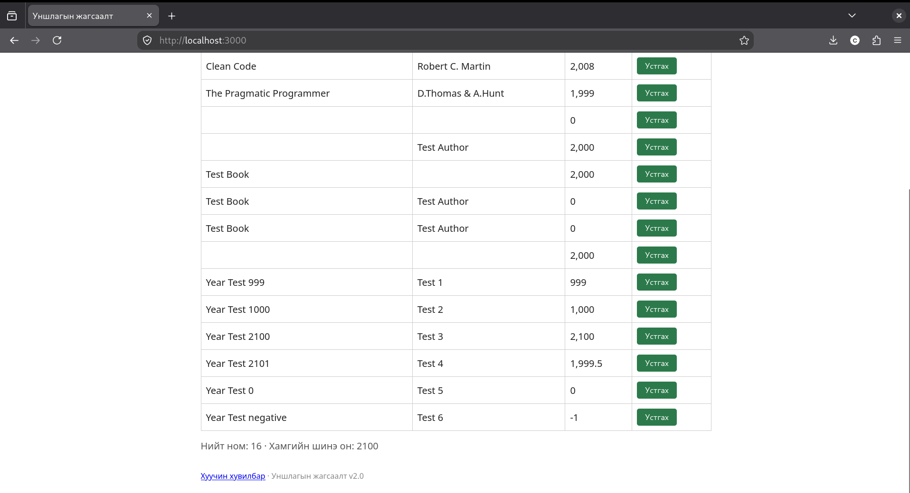
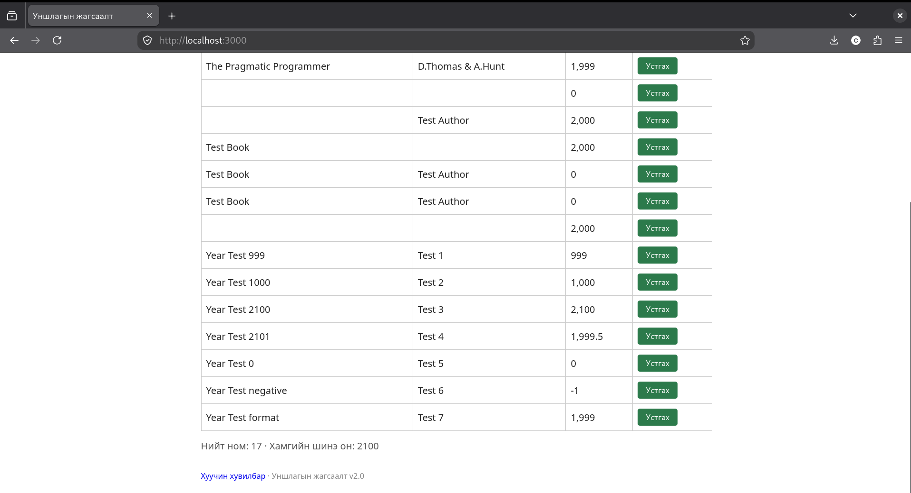

# BUG-02: Хязгаараас гадуурх болон бутархай онтой ном нэмэгддэг

## Орчин

- Апп: Уншлагын жагсаалт v2.0
- Node.js: v20.19.2
- Git: 2.47.3
- curl: 8.14.1
- browser: Mozilla Firefox 153.4.0esr
- Үйлдлийн систем: Linux
- Огноо: 2026-10-20

## Урьдчилсан нөхцөл

Дахин шалгахдаа `node app.js`-ийг шинээр асааж, http://localhost:3000 хуудсыг шинэчилнэ. Анхны 3 номтой төлөвөөс эхэлнэ.

## Дахин гаргах алхам

1. http://localhost:3000 хаягийг нээнэ.
2. Гарчигт `Year Test 999` оруулна.
3. Зохиолчийн утга: Test 1
4. Онд `999` оруулж ном нэмнэ.

## Хүлээгдэж байсан үр дүн

Он 1000–2100 хоорондох бүхэл тоо байна. 999 утгатай ном нэмэгдэхгүй.

## Бодит үр дүн

999 утгатай ном нэмэгдсэн.

## Ноцтой байдал

Major — Хүчингүй оны өгөгдөл зөвшөөрөгдөж байна.

## Нотолгоо

## Олдсон аялал

Antisocial - хүрээнээс гадуурх, бутархай болон сөрөг оны утгуудаар шалгах үед илэрсэн.

## Нэмэлт тэмдэглэл

Session-ийн үед 999, 1999.5, 0, -1 утгуудтай ном нэмэгдсэн.
Эдгээр нь зөвшөөрөгдөх оны шаардлагыг хангахгүй.

1000 болон 2100 утгуудтай ном нэмэгдсэн нь зөв үр дүн.
1999 он хүснэгтэд энгийн тоогоор харагдсан.