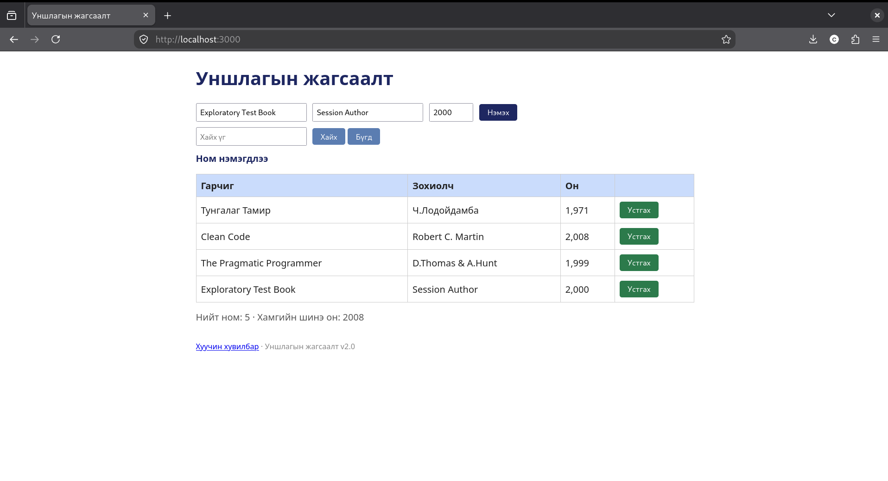
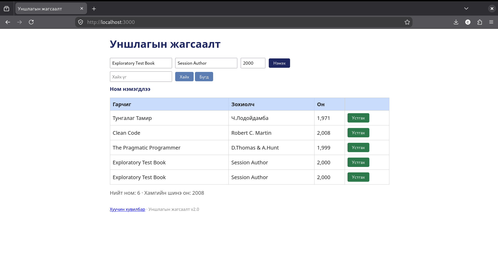

# BUG-04: Ижил гарчиг зохиолчтой ном давхар нэмэгддэг

## Орчин

- Апп: Уншлагын жагсаалт v2.0
- Node.js: v20.19.2
- Git: 2.47.3
- curl: 8.14.1
- browser: Mozilla Firefox 153.4.0esr
- Үйлдлийн систем: Linux
- Огноо: 2026-10-20

## Урьдчилсан нөхцөл

Дахин шалгахдаа `node app.js`-ийг шинээр асааж, http://localhost:3000 хуудсыг шинэчилнэ. Анхны 3 номтой төлөвөөс эхэлнэ.

## Дахин гаргах алхам

1. http://localhost:3000 хаягийг нээнэ.
2. `Exploratory Test Book`, `Session Author`, `2000` утгаар ном нэмнэ.
3. Яг ижил гурван утгаар дахин ном нэмнэ.
4. Хүснэгтэд ижил хоёр ном байгаа эсэхийг шалгана.

## Хүлээгдэж байсан үр дүн

Ижил гарчиг, зохиолчтой хоёр дахь ном нэмэгдэхгүй.

## Бодит үр дүн

Ижил гарчиг, зохиолчтой хоёр дахь ном нэмэгдсэн.

## Ноцтой байдал

Major — Давхардал хориглох дүрэм зөрчигдсөн.

## Нотолгоо

## Олдсон аялал

Fed-Ex - ижил өгөгдлийг давтан нэмэхэд жагсаалтад хэрхэн хадгалагдахыг ажигласан.