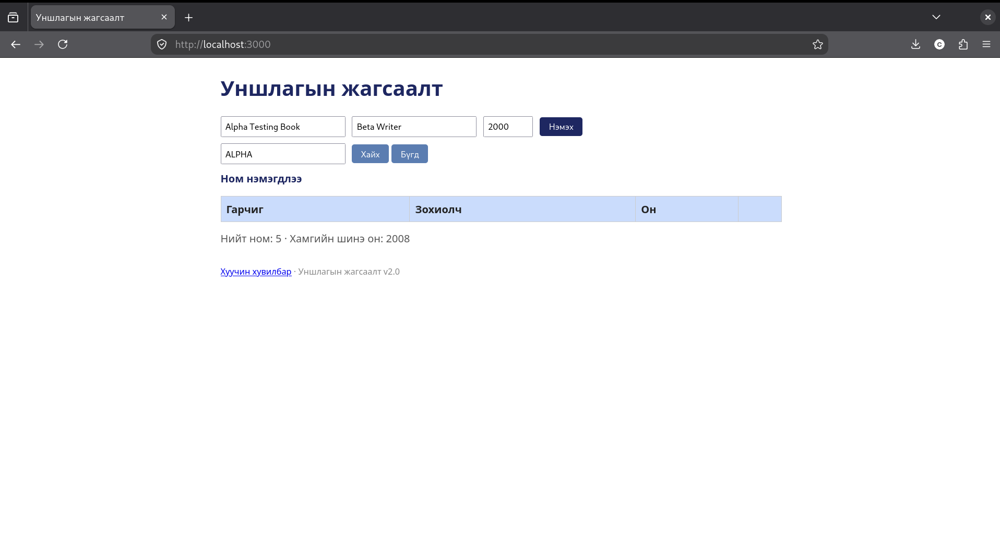
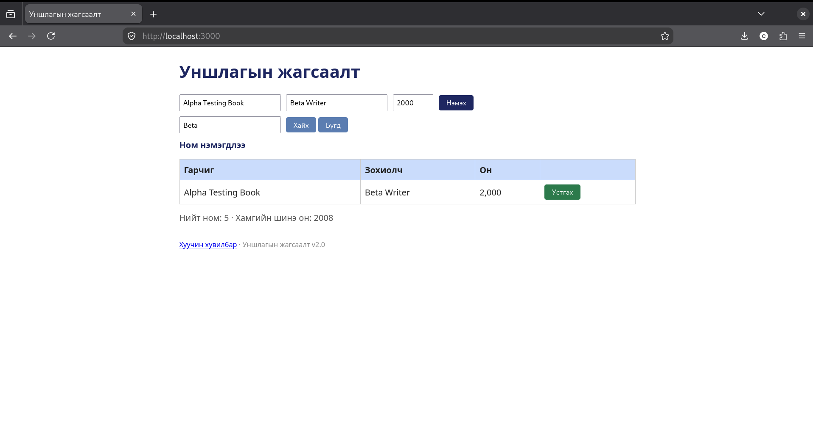
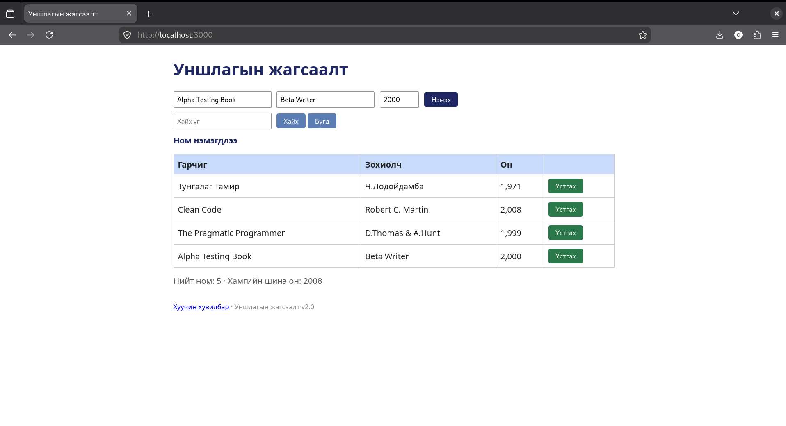

# BUG-05: Хайлт том жижиг үсэг ялгадаг

## Орчин

- Апп: Уншлагын жагсаалт v2.0
- Node.js: v20.19.2
- Git: 2.47.3
- curl: 8.14.1
- browser: Mozilla Firefox 153.4.0esr
- Үйлдлийн систем: Linux
- Огноо: 2026-10-20

## Урьдчилсан нөхцөл

Дахин шалгахдаа `node app.js`-ийг шинээр асааж, http://localhost:3000 хуудсыг шинэчилнэ. Анхны 3 номтой төлөвөөс эхэлнэ.

## Дахин гаргах алхам

1. http://localhost:3000 хаягийг нээнэ.
2. `Alpha Testing Book`, `Beta Writer`, `2000` утгаар ном нэмнэ.
3. Хайлтын талбарт `Alpha` бичиж үр дүнг ажиглана.
4. Хайлтыг `alpha`, дараа нь `ALPHA` болгож өөрчилнө.
5. Хайлтыг `Beta`, дараа нь `beta` болгож харьцуулна.

## Хүлээгдэж байсан үр дүн

Хайлт гарчиг, зохиолчоос том/жижиг үсэг ялгахгүй хайж, бүх хувилбарт тухайн ном олдоно.

## Бодит үр дүн

`Alpha`, `Beta` үед олдсон; `alpha`, `ALPHA`, `beta` үед олдоогүй.

## Ноцтой байдал

Major — Хайлтын шаардлагатай зан төлөв зөрчигдсөн.

## Нотолгоо

## Олдсон аялал

Antisocial - хайлтын оролтын том, жижиг үсгийг өөрчилж үр дүнг харьцуулсан.

## Нэмэлт тэмдэглэл

Хайлтыг цэвэрлэхэд бүрэн жагсаалт сэргэсэн. Байхгүй хайх товчийг алхамд нэмээгүй.