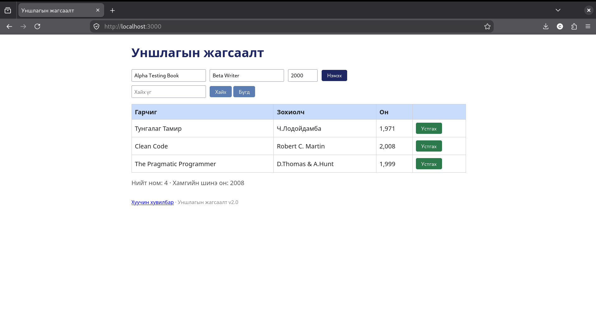

# BUG-06: Нийт номын тоолуур мөрийн тооноос нэгээр их

## Орчин

- Апп: Уншлагын жагсаалт v2.0
- Node.js: v20.19.2
- Git: 2.47.3
- curl: 8.14.1
- browser: Mozilla Firefox 153.4.0esr
- Үйлдлийн систем: Linux
- Огноо: 2026-10-20

## Урьдчилсан нөхцөл

Дахин шалгахдаа `node app.js`-ийг шинээр асааж, http://localhost:3000 хуудсыг шинэчилнэ. Анхны 3 номтой төлөвөөс эхэлнэ.

## Дахин гаргах алхам

1. http://localhost:3000 хаягийг нээнэ.
2. Хайлтын талбар хоосон байгааг шалгана.
3. Анхны 3 ном болон нийт номын тоолуурыг харьцуулна.
4. Бүх номыг хүснэгтийн устгах товчуудаар устгана.
5. Хоосон хүснэгт болон тоолуурыг харьцуулна.

## Хүлээгдэж байсан үр дүн

3 номтой үед 3, бүх номыг устгасны дараа 0 байна.

## Бодит үр дүн

Анхны 3 номтой үед 4, хоосон үед 1 харагдсан. Session-д нэг ном нэмэхэд тоолуур 5 болсон.

## Ноцтой байдал

Minor — Нийт тоог буруу мэдээлж байна.

## Нотолгоо

## Олдсон аялал

Fed-Ex - ном нэмэх, устгах үед жагсаалт болон тоолуурын өөрчлөлтийг харьцуулсан.
