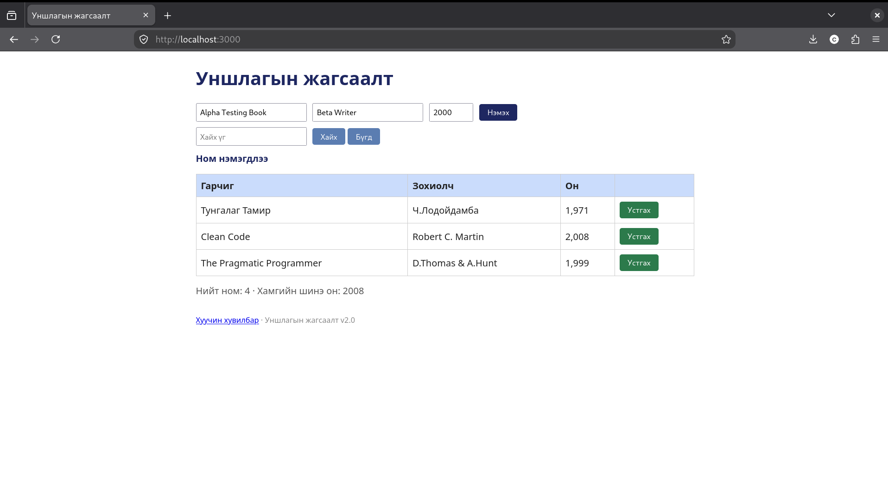

# BUG-07: Устгах товч улаан өнгийн оронд ногоон харагддаг

## Орчин

- Апп: Уншлагын жагсаалт v2.0
- Node.js: v20.19.2
- Git: 2.47.3
- curl: 8.14.1
- browser: Mozilla Firefox 153.4.0esr
- Үйлдлийн систем: Linux
- Огноо: 2026-10-20

## Урьдчилсан нөхцөл

Дахин шалгахдаа `node app.js`-ийг шинээр асааж, http://localhost:3000 хуудсыг шинэчилнэ. Анхны 3 номтой төлөвөөс эхэлнэ.

## Дахин гаргах алхам

1. http://localhost:3000 хаягийг нээнэ.
2. Анхны хүснэгтийн устгах товчийг ажиглана.

## Хүлээгдэж байсан үр дүн

Спецификацийн дагуу Устгах товч улаан байна.

## Бодит үр дүн

Устгах товч ногоон байсан.

## Ноцтой байдал

Cosmetic — Аюултай үйлдлийн өнгө тодорхойлолттой нийцэхгүй.

## Нотолгоо

## Олдсон аялал

Supermodel - интерфейсийн товчны өнгийг спецификацитай харьцуулсан.

