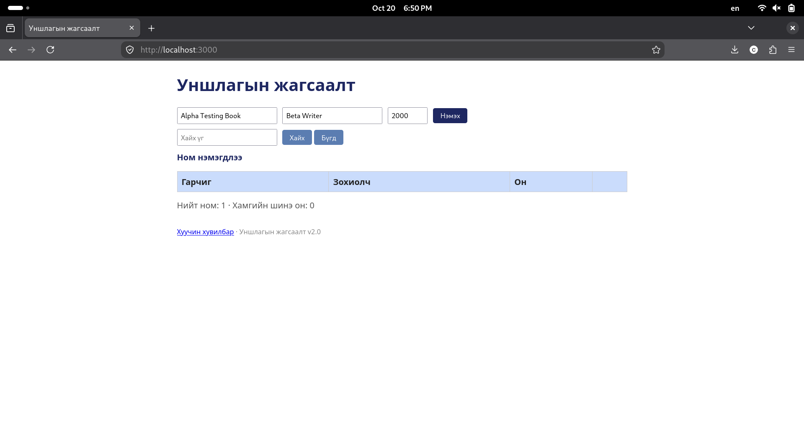
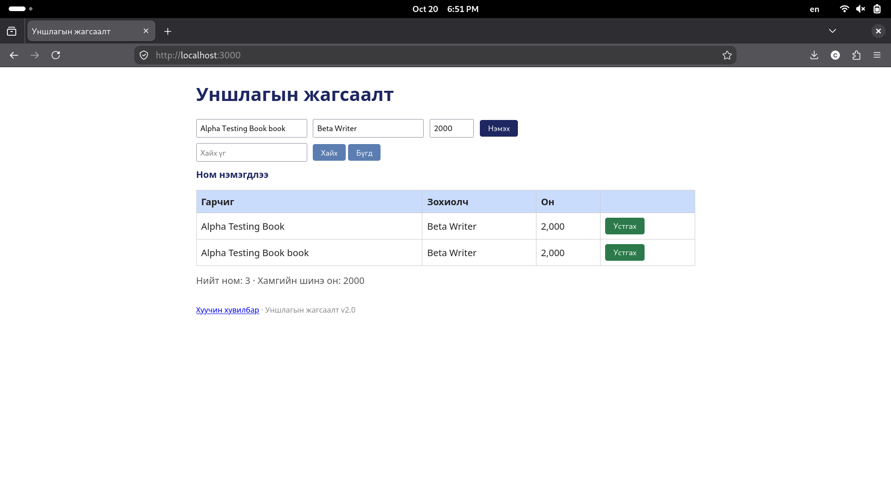

# BUG-08: Урт текст хүснэгтийн харагдах байдлыг эвддэг

## Орчин

- Апп: Уншлагын жагсаалт v2.0
- Node.js: v20.19.2
- Git: 2.47.3
- curl: 8.14.1
- browser: Mozilla Firefox 153.4.0esr
- Үйлдлийн систем: Linux
- Огноо: 2026-10-20

## Урьдчилсан нөхцөл

Дахин шалгахдаа `node app.js`-ийг шинээр асааж, http://localhost:3000 хуудсыг шинэчилнэ. Анхны 3 номтой төлөвөөс эхэлнэ.

## Дахин гаргах алхам

1. http://localhost:3000 хаягийг нээнэ.
2. Гарчигт Alpha Testing Book 
3. Зохиолч болон он: Beta Writer 2000 
4. Ном нэмээд хүснэгтийн бүтцийг ажиглана.

## Хүлээгдэж байсан үр дүн

Спецификацийн дагуу хүснэгт ямар ч урттай оролтод эвдрэхгүй.

## Бодит үр дүн

Урт гарчиг болон зохиолчийн нэртэй ном нэмэхэд
хүснэгтийн хэмжээ өөрчлөгдөж, багануудын байрлал алдагдсан.
Урт текстийг харуулах үед хүснэгтийн layout хэвийн хадгалагдаагүй.

## Ноцтой байдал

Minor — Хүснэгтийн харагдах байдал урт оролтод алдагдсан гэж ажигласан; бодит нөлөөг дахин баталгаажуулна.

## Нотолгоо

## Олдсон аялал

Supermodel урт текстийн үед хүснэгтийн харагдах байдлыг ажигласан.